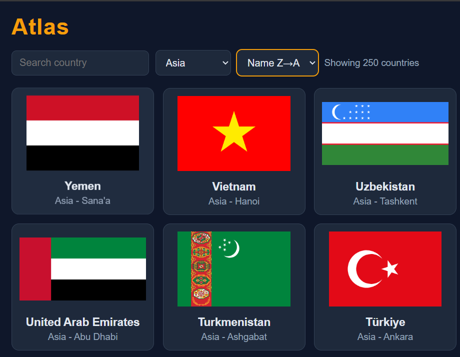

# 🌍 Atlas — Country Explorer

Search, filter and sort every country in the world. The data is fetched over HTTP with async/await and then filtered locally.

**🔗 Live demo:** https://ahmed71huz.github.io/country-explorer/

## Features
- Data for 250 countries fetched once with `fetch`, then filtered locally
- Search by name and filter by region, both working together
- Sort by name, A→Z or Z→A
- Loading and error states
- Country details popup: official name, region, area, languages and borders
- Responsive card grid built with CSS Grid
- Dark theme with CSS variables

## Tech Stack
HTML5 · CSS3 · Vanilla JavaScript · world-countries data · flagcdn · GitHub Pages

## Run Locally
1. `git clone https://github.com/ahmed71huz/country-explorer.git`
2. Open `index.html` in your browser (or use Live Server).

## What I Learned
- Fetching JSON from the web with `fetch` and `async/await`, and handling failures with `try/catch` and `res.ok`.
- Keeping the data in one array and letting search, region filter and sort all work through one `applyFilters()` function.
- Sorting a copy of an array with `[...list].sort()` and `localeCompare`, so the original array stays untouched.
- Opening a details popup from a card click, and handling missing data (like Antarctica with no languages) with fallbacks.
